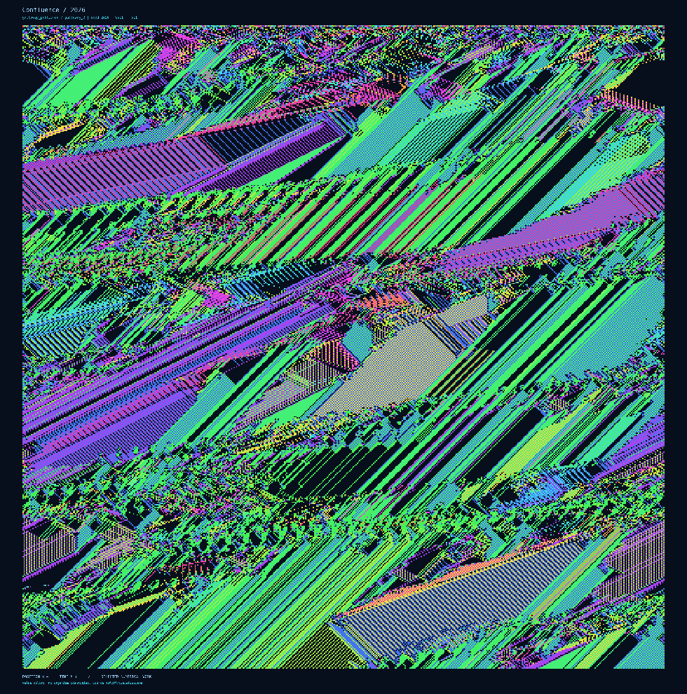
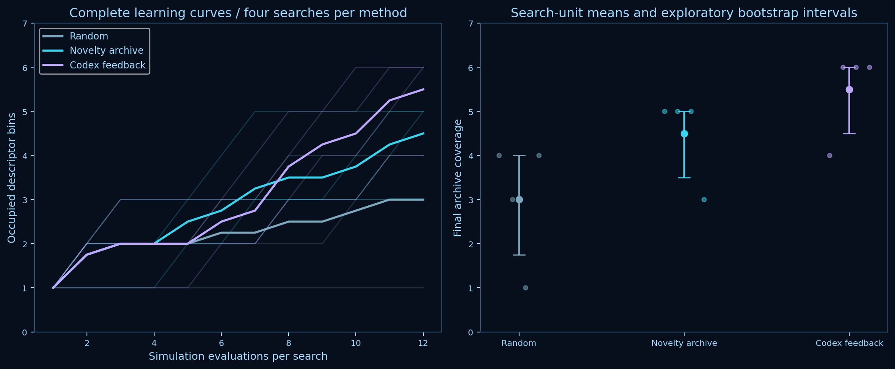
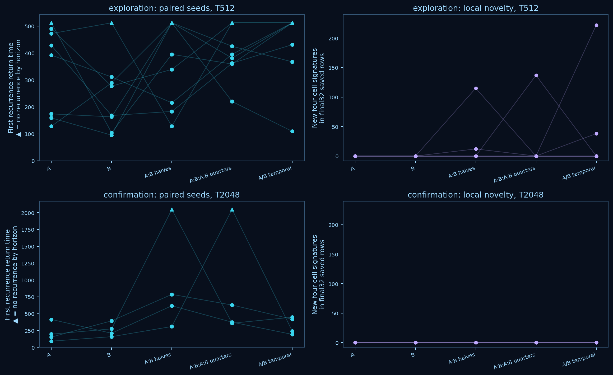

# Barricelli–symbiogenesis

**A developing ALife laboratory and numerical art instrument. First implementation milestone, 10 October 2026.**

[Open the offline atlas](atlas/index.html) · [All retained runs](atlas/register.html) · [Numerical register](results/run_register.csv) · [Sources and semantics](PROVENANCE.md) · [Experiment record](RESEARCH_RECORD.md)



*Confluence / 2026.* Selected aesthetic illustration, `galloway_published`, seed 2026, 511 positions and 511 updates. Horizontal position increases rightward; **time increases downward**. Every pixel comes from a saved numerical history. [4919 × 4968 print](results/art/confluence.png), [progressive reveal](results/art/confluence.gif), [render recipe](results/art/confluence.recipe.json). Selection for beauty is separate from scientific sampling.

## Question and abstract

Which persistent numerical patterns are reproductively coherent collectives whose reproduction depends on their organization and particular partners? Alongside this scientific question, the laboratory asks what conversational model assistance contributes to discovery, and how numerical dynamics can support reproducible visual art.

The implementation reproduces all 22 documented historical examples exactly against 16,694 reference-fixture cells. An independent implementation of the retrieved Galloway sketch agrees with a source-level Java oracle across 1,597,386 cells. The laboratory retains 491 simulation trajectories, with a browsable atlas, three prints and reveal animations. Equal-budget searches cover 3.0, 4.5 and 5.5 numerical descriptor bins on average for random, novelty-archive and conversational Codex policies respectively; four searches per method and shared model context limit inference. Matched environments sometimes prolong local novelty at 512 updates, but fresh 2,048-update runs show no unseen four-cell signatures in their final windows. Component interventions demonstrate arrangement-specific domain propagation; no additional detached recoverable collective copies meet the declared criterion. These results establish reconstruction and exploratory causal evidence, without establishing symbiogenesis or open-ended evolution.

## Related work and scope

Barricelli's [1954 paper in the 2026 Bianchi–Taylor translation](https://www.tim-taylor.com/papers/barricelli2026numerical.pdf), their [separate commentary](https://www.tim-taylor.com/papers/taylor2026commentary.pdf), and [Taylor's GPL reference implementation](https://github.com/tim-taylor/barricelli54) ground the historical profile. The inspected commit is `beeea928d17c73a66ff5dccee19270ba717596ac`. The commentary distinguishes historical experiments and explains errors in Figure 15. The 1957 paper is a distinct account, rather than an English republication of 1954.

[Galloway's reconstruction](https://cultureandcommunication.org/galloway/Barricelli/), [published sketch](https://cultureandcommunication.org/galloway/Barricelli/Barricelli.pde) and [retrospective](https://cultureandcommunication.org/galloway/ephemera-pt-3-barricelli) provide both a behavioral reference and an artistic precedent. His work is also credited in [chapter 5, Figure 5.4](https://www.tim-taylor.com/selfrepbook/web/chapter-5.html), the context of the user's example image. No explicit software license was found for the sketch. Its whole program is not redistributed; this repository implements its inspected numerical behavior independently.

The [March 2026 SymBa workshop report, `2603.08463v1`](https://arxiv.org/html/2603.08463v1), already reconstructs and extends Barricelli systems. Its [source repository](https://github.com/JELAshford/symba-alice-2026) was inspected at `2b6fc9375553ccdb6c955f271889a762c1624039`. Replication itself is not new science here. Its set-valued simultaneous collision aggregation differs from the sequential published Galloway sketch. The [July GECCO Companion paper](https://doi.org/10.1145/3795101.3814707) is a separate version; its full PDF was inaccessible and its full experimental overlap has not been excluded.

[ASAL, `2412.17799v2`](https://arxiv.org/html/2412.17799v2), and [ASAL++, `2509.22447v1`](https://arxiv.org/html/2509.22447v1), motivate comparing random exploration, novelty search and feedback-informed model proposals. This milestone uses numerical descriptors and conversational proposals, rather than replicating their embedding evaluators or automated model integrations. [Computational Life, `2406.19108v2`](https://arxiv.org/html/2406.19108v2), and its [BFF follow-up, `2607.01483v1`](https://arxiv.org/html/2607.01483v1), motivate separating discovery, functional reproduction and spread. [Distributed replication, `2508.08047v1`](https://arxiv.org/html/2508.08047v1), motivates ancestry and partner tracing; [Programmable Cellular Automata, `2609.06102v2`](https://arxiv.org/html/2609.06102v2), motivates inspectable rule variants. [Lenia](https://arxiv.org/html/1812.05433v3) offers a morphology-atlas precedent, while [Karl Sims's Genetic Images](https://www.karlsims.com/genetic-images.html) situates externally imposed aesthetic selection. These are related systems, not engines executed or substituted here. Version-specific methods and cautions are recorded in [the research notes](references/RELATED_WORK.md).

## Mathematical mechanisms and profiles

A world is an integer row (a_t(x)). Zero is empty. In the historical exclusion/conditional norms the reserved marker `X` (stored as 99999) is excluded space, rather than a numerical type. Each update starts with a blank next row and visits source positions in ascending order. Old-row helpers remain fixed while next-row collisions accumulate sequentially.

| Explicit profile | Initialization and boundary | Implemented semantics |
|---|---|---|
| `barricelli1954_reference` | Actual fixed row, dimensions and horizon of each of Figures 1–22; open boundaries | Unchanged Taylor basic, symbiotic, exclusion or conditional functions, with observational hooks. |
| `galloway_published` | Frozen integer row; ring width 511; default 511 updates | Retrieved sketch's effective B norm, original-source offsets, equal helpers, three attempts and reusable erased targets. |
| `research` | Explicit seed or frozen row; every change declared | Historical conditional/exclusion assays, scaled published-style worlds, A/B/zero collision variants, spatial mixtures and temporal control. |

For historical basic copying, the actual sequential accumulation at target (j) from source (i) is (n_j \leftarrow n_j+a_i-a_j\mathbf{1}[n_j\ne0]), applied to self-retention and the displaced target (i+a_i). It should not be replaced with a conventional cellular-automaton collision rule. In assisted copying, a source value (v=a_i) initially targets (i+v); if the old row at that target supplies eligible helper (h), the next attempt targets **(i+h)**. The offset remains relative to the original source. Historical helpers exclude equal values; the published Galloway sketch permits them.

Historical exclusion writes `X` on unequal collisions. Conditional mutation beneath an old-row empty/excluded site uses the distance between nearest valid left and right old-row numbers, positive for equal signs and negative otherwise; missing neighbors leave `X`. Galloway instead clears occupied-old-target collisions to 0 and mutates empty-old-target collisions to signed (u+v-1), with distances measured on the ring. His sketch's intended A regions are unreachable: every destination 0–510 falls into a B branch. Research A uses signed (u+v); the named spatial and temporal variants deliberately expose these different formulas. Mixture neighbor searches cross region boundaries through the full old ring. These choices are visible in code and configuration.

The original Galloway float initialization samples `[-18,19)` and truncates toward zero. Zero has twice the usual interval width, and −18 is an endpoint case. Here PCG64 supplies seeded float32 draws; integer rows, rather than matching seeds, support comparisons between runtimes. Published rendering uses white for 0 and values outside its explicit palette. The research renderer distinguishes both and records the shared palette.

## Experimental design

**Interpretation.** Persistence is continued recovery of a declared motif; motion is its displacement; expansion is increasing occupied domain or template count. Additional recoverable separated copies are a reproductive outcome. Inheritance requires an identified parent–descendant relation with retained structure; variation requires a change in that inherited structure. Selection requires differential persistence/reproduction in a population. Component sensitivity alone does not establish reciprocal dependence. Entropy, novel values, stripe motion and lack of recurrence do not establish open-ended evolution.

**Discovery.** All three methods search the same 48 configurations: four declared integer alphabets, four occupancies (0.15, 0.35, 0.65, 0.90), and uniform, central-patch or two-patch initialization. Norm B, width 128, 256 updates and rendering remain fixed. Each method executes four repeated searches of 12 evaluations: **393,216 cell updates per search**, including the same four bootstrap evaluations and seed schedule. Random search samples untested configurations uniformly; novelty search chooses a numerically novel evaluated parent and an untested one-factor neighbor. Codex receives saved numerical feedback in two rounds and submits four logged hypotheses per search per round. No target picture or cell-level model directs trajectories.

The primary archive bins occupancy, cell-change fraction and repeated-four-cell-window fraction into five bins each. Supplementary measures include compression, exact translation within ±8 cells, whole-world recurrence, entropy, retained repeated signatures and unseen local signatures. Windows eligible for structural counting contain at least two occupied sites and two distinct numerical types. Retained signatures occur in at least eight of the last 16 rows; novelty concerns the last 32 rows. These are interpretable diagnostics, not organism detectors. Explicitly imposed static, period-two, translating, noisy and empty histories calibrate them. A selected configuration per method is checked on seeds 9100–9103 at 1,024 updates, selected before seeing confirmation outcomes by distance from a fixed period-two descriptor.

**Environment.** Width, initial integer row and update budget are paired across homogeneous A, homogeneous B, spatial halves A:B, spatial quarters A:B:A:B and whole-world temporal A/B. Eight exploratory seeds run 512 updates; four fresh confirmation seeds run 2,048. Contrasts compare mixtures with the paired mean of their homogeneous constituent effects. Recurrence includes temporal environment phase. Forty perturbation replays clear sites 48–55 in saved row 256 and run 128 further updates, compared with the saved undamaged continuation. Clearing, layouts and norm assignments are explicit external interventions.

**Causal assay.** The historical Figure 7 candidate is `[5,-3,1,-3,0,-3,1,0]`; the generated candidate is `[1,-1,1,-1]`, extracted by a declared earliest eligible repeated-window rule from conditional seed 3002 at time 10. Exact translated templates, with zero value/spacing tolerance and period-one temporal matching, are tested for 48 updates in width-256 worlds. Empty, representative resident and available original-ecology backgrounds are paired with placements 16, 112 and 232; the generated candidate also uses its original placement. Conditions include intact, separated numerical types, removal, exact rescue, composition-preserving shuffle, wrong-value replacement and equal-loss controls. Every condition is retained.

The conservative reproductive criterion requires additional disjoint template footprints with two empty exterior cells, followed by recoverability in eight-update isolated replay. Continuous tiling fails detachment even when many template matches appear. Scoped copy events identify the copied source and ordered helpers. This criterion can miss distributed reproduction; it does not assign lineage from value equality alone.

## Results

### Validated reconstruction


Figures 2, 5, 7, 8, 12 and 18 illustrate displacement, assisted copying, collective propagation, crossing, collision mutation and host-dependent patterns. All 22 examples agree exactly with the upstream executable and numerical fixtures. Each panel identifies its fixed initial-state reference, width and horizon. [Full agreement table](results/reconstruction/agreement.json).


Figure 15 agrees with the corrected fixture. The historical-plate transcription first differs at time 8, positions 51, 56 and 58. Its 5,091 later unequal cells reflect propagated differences, rather than 5,091 independent historical errors. No cells were patched for visual agreement.


All six unselected display-scale initial rows (seeds 2026–2031) were run and checked against unchanged numerical method bodies compiled with Java. Six adversarial rows cover wrapping, equal helpers, mutation, occupied-target erasure and later reuse. There are zero numerical mismatches across 1,597,386 cells. This validates source-level arithmetic and update behavior, rather than the Processing UI, random stream or pixel identity of the original artwork. Final occupancies range from 236 to 510 of 511 cells. No whole-row recurrence is observed within this display horizon; it remains a finite observation.

### Discovery comparison and confirmation



| Method | Coverage in four searches | Mean coverage; exploratory 95% interval | Mean nearest descriptor distance | Discovery native process time / descriptor time |
|---|---|---|---|---|
| Random | 4, 3, 1, 4 | 3.0 [1.75, 4.00] | 0.0576 | 1.07 s / 46.24 s |
| Novelty archive | 5, 5, 5, 3 | 4.5 [3.50, 5.00] | 0.0867 | 0.96 s / 47.65 s |
| Codex feedback | 4, 6, 6, 6 | 5.5 [4.50, 6.00] | 0.0991 | 1.11 s / 54.03 s |

All 144 evaluations are included. The paired coverage differences from random are +1.5 bins for novelty (interval −0.25 to 3.25) and +2.5 for Codex (0.75 to 4.25). Intervals bootstrap **search units**, not time points. Four units and a shared conversational context make these descriptive exploratory estimates. Descriptor evaluation dominates native simulation time. Two feedback-to-proposal wall intervals were 106.7 and 109.9 seconds, including other work; isolated model time, tokens and cost were not separately measurable. There were no external model API calls or paid calls. [The model-use record](results/model_use.json) separates proposal activity from an aggregate whole-goal usage meter. This is executed conversational Codex-assisted exploration, with no automated model integration.

All 12 fresh-state, longer-horizon checks recur by 1,024 updates and produce no unseen four-cell signatures in the final window. The selected Codex configuration yields one sparse moving recurrent pattern and three dense recurrent outcomes. The short-horizon archive gain therefore does not imply sustained innovation. [Complete comparison](results/search/summary.json), [feedback and proposal logs](results/search/), [confirmation outcomes](results/search_confirmation/summary.json).

### Heterogeneity: delayed recurrence, limited novelty



| Environment | Recurrence by 512, of 8 | Mean final-window new signatures at 512 | Recurrence by 2,048, of 4 | Mean new signatures at 2,048 |
|---|---:|---:|---:|---:|
| Homogeneous A | 7 | 0 | 4 | 0 |
| Homogeneous B | 7 | 0 | 4 | 0 |
| Spatial halves | 5 | 15.875 | 3 | 0 |
| Spatial quarters | 6 | 17.125 | 3 | 0 |
| Temporal A/B | 3 | 32.500 | 4 | 0 |

At 512 updates some mixtures retain local novelty while both homogeneous controls have none in their final windows. At 2,048 updates all confirmation worlds have zero late unseen signatures, including two spatial worlds without observed whole-world recurrence. Recurrence absence can therefore coexist with no measured new local structure.

Confirmation differences in retained signatures from the paired constituent mean are −1.25 for halves (interval −9.125 to 5.625) and −0.75 for quarters (−9.875 to 6.875). This small experiment gives no clear evidence that spatial heterogeneity sustains inherited organization. These signatures are not recoverable collective diversity or inherited variants. The 40 damage replays have mixed effects; mean repeated-window change ranges from −0.0904 in quarters to +0.0737 under temporal alternation, without an established collective recovery interpretation. [All baselines, paired contrasts and damage outcomes](results/heterogeneity/summary.json).

### Partner specificity and the reproduction boundary


For the historical candidate at placement 112, the value 5 copies to 117, then the old-row helper −3 at 117 enables its copy to 109. Events record both source and partner. The original assay's deletion at motif offset 1 recovers after two updates in empty backgrounds. This unsuccessful partner-removal hypothesis remains in the results.


A separately declared, exploratory 24-run follow-up targets the direct helper at offset 5. Across all three empty-background placements, removing that helper or replacing −3 with −4 prevents recovery of the exact motif. Deleting the same numerical type at offset 1 allows recovery; restoring the direct helper reproduces the intact trajectory exactly. Resident backgrounds usually disrupt the motif. This supports arrangement-specific propagation, with gap-control imperfections still present.

The historical intact candidate reaches 21 disjoint matches in an occupied domain by time 48 at the central empty placement; the generated candidate reaches 25. **Neither produces additional detached recoverable copies under the assay criterion.** All 162 paired conditions, two viability probes and the follow-up are retained. The generated shuffle is effectively a phase shift, and its original ecology contains other matching templates, so template equality cannot resolve ancestry. No nonzero integer is a neutral filler. Removal changes occupancy and gap geometry; wrong-value replacement preserves those features but changes displacement. [Complete assay](results/assay/summary.json), [follow-up](results/partner_followup/summary.json), [all settings figure](results/figures/assay_all_settings.png).

## Art, discussion and limitations

The local atlas exposes 19 saved worlds, integer readouts, textual close-ups, progressive reveal and four saved nearby configuration variants. Three explicitly selected artworks—*Confluence*, *Strata* and *Fault lines*—have 4919 × 4968 prints, streamed 40-frame GIFs and exact rendering recipes. Initial conditions, norm choices and curation are human/Codex design interventions; numerical structures arise through the simulator. A complete native-run register sits alongside the curated collection. The shared palette is expressive but does not distinguish every possible integer perceptually, so numerical views remain essential.

The reconstruction is the strongest result. The exploratory search gain is confined to a declared descriptor archive and a small budget; simpler periodic domains can score highly in activity, repetition and compression. [Saved diagnostic controls](results/figures/descriptor_controls.png) make this ambiguity visible: period-two motion has activity 1, while noise has high entropy without retained repeated structure. Neither implies life. Source-level fidelity also does not validate every historical verbal claim.

The causal outcome is domain propagation with partner-arrangement sensitivity. It falls short of detached collective reproduction, mutual dependence or inheritance. The contiguous detector may miss distributed cooperating structures; complete branching ancestry and a validated distributed viability detector remain unfinished science. Motif extraction and the dependency-directed follow-up are exploratory, the resident background is a representative single realization, and longer confirmation cohorts are small. Long-horizon environment confirmation uses fresh states; exceptional exploratory histories were not individually extended beyond 512 updates, so their longevity remains unresolved. The finite rule set and descriptor choices constrain discovery. No result here demonstrates open-ended evolution, intelligence or recursive self-improvement.

**Next single scientific question:** can a dependency-defined motif, including its local partners, produce two spatially separated recoverable descendants with identifiable branching ancestry, rather than extend a tiled domain? A follow-up should first build and validate that detector on known cases. A subsequent environmental campaign can compare inherited variants and collective recovery under homogeneous and heterogeneous norms, using fresh seeds, measured throughput and precision requirements; parallel-world exchange remains deferred.

## Reproducibility

The saved baseline contains **491 native runs and 18,911,625 cell updates**. Their complete current-engine replay checks 19,000,824 saved cells and all nine event counters. The retained native runs sum to 6.80 s of engine time and 13.08 s of native process time, with a maximum native footprint of 3.75 MiB. The full resume/regeneration command completed in 53.29 s with a measured peak of 255.16 MiB. Timing is machine-dependent; native process time and engine time include CSV output, while descriptor, rendering, compilation, oracle and verification work have separate costs. [Resource summary](results/resource_summary.json), [full regeneration measurement](results/milestone-resource.txt), [machine record](results/machine.json), [replay report](results/replay_verification.json) and [test output](results/test-results.txt) provide measured scope. The development machine is an 8-logical-CPU i5-1035G1 WSL2 instance with approximately 3.7 GiB RAM and substantial existing swap use. Batches execute serially, native trajectories stream to disk, and GIF frames are streamed.

From the repository root:

```bash
python3 -m venv .venv
.venv/bin/pip install -r requirements.txt
make test
make reproduce                 # resumes recorded searches; no model calls
```

Replay and inspect the atlas by opening `atlas/index.html` in a browser, or serving the repository locally:

```bash
python3 -m http.server 8000 --bind 127.0.0.1
# Browse http://127.0.0.1:8000/atlas/
```

Run a named profile, render it separately, or explore a recorded neighborhood:

```bash
.venv/bin/python -m barricelli --config configs/galloway_published.json \
  --seed 2026 --steps 511 --output results/my_world
.venv/bin/python -m barricelli.plot results/my_world \
  --mode research --output results/my_world/view.png
.venv/bin/python scripts/nearby.py \
  --run results/search/codex_feedback/repeat3/trial07 \
  --output results/my_neighbors --seed 9300 --steps 1024
```

`--initial-state path/to/initial.csv` supplies an exact integer row. Historical reference configurations reject altered figure horizons, rows or dimensions; deliberate changes require the research profile and declared modifications. The pinned environment needs Python 3.10+, g++, GNU time and system DejaVu fonts for prints. Java is needed only to regenerate the optional source-level oracle; frozen outputs support offline checks. Source retrieval scripts require network access, but simulation, plots, recorded search replay and the atlas require no model or hosted service. Optional browser QA uses a separately installed Playwright/Chromium development dependency.

The project remains compact: `engine/`, `barricelli/`, named `configs/`, numerical `fixtures/`, experiment/rendering `scripts/`, `results/`, the local `atlas/` and `references/`. [AGENTS.md](AGENTS.md) carries the mission, [RESEARCH_RECORD.md](RESEARCH_RECORD.md) records decisions and findings, and [DEVELOPMENT_LOG.md](DEVELOPMENT_LOG.md) records implementation history. [License and attribution](NOTICES.md) retain Taylor's GPL notices and acknowledge Galloway without redistributing his unlicensed sketch. The buildable [source snapshot](results/source_snapshot.tar.gz) and [manifest](references/source_manifest.json) provide content-based version identity for this initially uncommitted repository.
