# Barricelli–symbiogenesis

**An ALife laboratory and numerical art instrument. Verified reference worlds, broader discovery, causal checks and Interfaces / R8, 10 October 2026.**

[Open the offline atlas](atlas/index.html) · [All retained runs](atlas/register.html) · [Numerical register](results/run_register.csv) · [Sources and semantics](PROVENANCE.md) · [Experiment record](RESEARCH_RECORD.md)

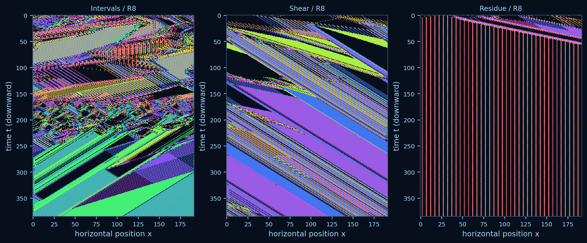

*Interfaces / R8:* **Intervals**, **Shear** and **Residue**. Every displayed cell derives from a saved integer trajectory. Position increases rightward; **time increases downward**. The collection retains transient-looking interfaces and a sparse periodic remnant. [Prints and animations](atlas/index.html#prints), [source/recipe manifest](results/discovery_art/art_manifest.json). Aesthetic choices are separate from scientific sampling.

## Question and abstract

Which persistent numerical patterns are reproductively coherent collectives whose reproduction depends on their organization and particular partners? Alongside this scientific question, the laboratory asks what conversational model assistance contributes to discovery, and how numerical dynamics can support reproducible visual art.

The implementation reproduces all 22 historical examples against 16,694 reference-fixture cells and independently matches the retrieved Galloway arithmetic across 1,597,386 oracle cells. The laboratory now retains 896 native trajectories, six curated prints/reveal animations and a 72-world offline atlas. R8 broadened discovery to 1,024 rule/initial-state configurations: random, novelty and Codex informed by visual feedback cover 6.25, 6.0 and 6.25 descriptor bins on average under matched budgets. No Codex coverage advantage appears; random has greater descriptor diversity. All 12 fresh 1,536-update confirmations become recurrent with zero late signature novelty. Targeted extraction, damage, shuffling, constituent rules and exact rescue separate persistent tiled spread from detached copying; no selected eight-cell case produces a certified pair in its short ancestry audit. Earlier R7 still supplies the independently verified designed partner-assisted copying positive. These are bounded numerical findings, while the new *Interfaces* series is an independently recorded aesthetic outcome.

## Related work and scope

Barricelli's [1954 paper in the 2026 Bianchi–Taylor translation](https://www.tim-taylor.com/papers/barricelli2026numerical.pdf), their [separate commentary](https://www.tim-taylor.com/papers/taylor2026commentary.pdf), and [Taylor's GPL reference implementation](https://github.com/tim-taylor/barricelli54) ground the historical profile. The inspected commit is `beeea928d17c73a66ff5dccee19270ba717596ac`. The commentary distinguishes historical experiments and explains errors in Figure 15. The 1957 paper is a distinct account, rather than an English republication of 1954.

[Galloway's reconstruction](https://cultureandcommunication.org/galloway/Barricelli/), [published sketch](https://cultureandcommunication.org/galloway/Barricelli/Barricelli.pde) and [retrospective](https://cultureandcommunication.org/galloway/ephemera-pt-3-barricelli) provide both a behavioral reference and an artistic precedent. His work is also credited in [chapter 5, Figure 5.4](https://www.tim-taylor.com/selfrepbook/web/chapter-5.html), the context of the user's example image. No explicit software license was found for the sketch. Its whole program is not redistributed; this repository implements its inspected numerical behavior independently.

The [March 2026 SymBa workshop report, `2603.08463v1`](https://arxiv.org/html/2603.08463v1), already reconstructs and extends Barricelli systems. Its [source repository](https://github.com/JELAshford/symba-alice-2026) was inspected at `2b6fc9375553ccdb6c955f271889a762c1624039`. Replication itself is not new science here. Its set-valued simultaneous collision aggregation differs from the sequential published Galloway sketch. The [July GECCO Companion paper](https://doi.org/10.1145/3795101.3814707) is a separate version; its full PDF was inaccessible and its full experimental overlap has not been excluded.

[ASAL, `2412.17799v2`](https://arxiv.org/html/2412.17799v2), and [ASAL++, `2509.22447v1`](https://arxiv.org/html/2509.22447v1), motivate comparing random exploration, novelty search and feedback-informed model proposals. This milestone uses numerical descriptors and conversational proposals, rather than replicating their embedding evaluators or automated model integrations. [Computational Life, `2406.19108v2`](https://arxiv.org/html/2406.19108v2), and its [BFF follow-up, `2607.01483v1`](https://arxiv.org/html/2607.01483v1), motivate separating discovery, functional reproduction and spread. [Distributed replication, `2508.08047v1`](https://arxiv.org/html/2508.08047v1), motivates ancestry and partner tracing; [Programmable Cellular Automata, `2609.06102v2`](https://arxiv.org/html/2609.06102v2), motivates inspectable rule variants. [Lenia](https://arxiv.org/html/1812.05433v3) offers a morphology-atlas precedent, while [Karl Sims's Genetic Images](https://www.karlsims.com/genetic-images.html) situates externally imposed aesthetic selection. These are related systems, not engines executed or substituted here. Version-specific methods and cautions are recorded in [the research notes](references/RELATED_WORK.md).

## Mathematical mechanisms and profiles

A world is an integer row (a_t(x)). Zero is empty. In the historical exclusion/conditional norms the reserved marker `X` (stored as 99999) is excluded space, rather than a numerical type. Each update starts with a blank next row and visits source positions in ascending order. Old-row helpers remain fixed while next-row collisions accumulate sequentially.

| Explicit profile | Initialization and boundary | Implemented semantics |
|---|---|---|
| `barricelli1954_reference` | Actual fixed row, dimensions and horizon of each of Figures 1–22; open boundaries | Unchanged Taylor basic, symbiotic, exclusion or conditional functions, with observational hooks. |
| `galloway_published` | Frozen integer row; ring width 511; default 511 updates | Retrieved sketch's effective B norm, original-source offsets, equal helpers, three attempts and reusable erased targets. |
| `research` | Explicit seed or frozen row; every change declared | Historical symbiotic/conditional/exclusion assays, designed dyads, scaled published-style worlds, A/B/zero collision variants, spatial mixtures and temporal control. |

For historical basic copying, the actual sequential accumulation at target (j) from source (i) is (n_j \leftarrow n_j+a_i-a_j\mathbf{1}[n_j\ne0]), applied to self-retention and the displaced target (i+a_i). It should not be replaced with a conventional cellular-automaton collision rule. In assisted copying, a source value (v=a_i) initially targets (i+v); if the old row at that target supplies eligible helper (h), the next attempt targets **(i+h)**. The offset remains relative to the original source. Historical helpers exclude equal values; the published Galloway sketch permits them.

Historical exclusion writes `X` on unequal collisions. Conditional mutation beneath an old-row empty/excluded site uses the distance between nearest valid left and right old-row numbers, positive for equal signs and negative otherwise; missing neighbors leave `X`. Galloway instead clears occupied-old-target collisions to 0 and mutates empty-old-target collisions to signed (u+v-1), with distances measured on the ring. His sketch's intended A regions are unreachable: every destination 0–510 falls into a B branch. Research A uses signed (u+v); the named spatial and temporal variants deliberately expose these different formulas. Mixture neighbor searches cross region boundaries through the full old ring. These choices are visible in code and configuration.

The original Galloway float initialization samples `[-18,19)` and truncates toward zero. Zero has twice the usual interval width, and −18 is an endpoint case. Here PCG64 supplies seeded float32 draws; integer rows, rather than matching seeds, support comparisons between runtimes. Published rendering uses white for 0 and values outside its explicit palette. The research renderer distinguishes both and records the shared palette.

## Experimental design

**Interpretation.** Persistence is continued recovery of a declared motif; motion is its displacement; expansion is increasing occupied domain or template count. Additional recoverable separated copies are a reproductive outcome. Inheritance requires an identified parent–descendant relation with retained structure; variation requires a change in that inherited structure. Selection requires differential persistence/reproduction in a population. Component sensitivity alone does not establish reciprocal dependence. Entropy, novel values, stripe motion and lack of recurrence do not establish open-ended evolution.

**Original discovery comparison.** All three methods searched the same 48 configurations: four declared integer alphabets, four occupancies (0.15, 0.35, 0.65, 0.90), and uniform, central-patch or two-patch initialization. Norm B, width 128, 256 updates and rendering remain fixed. Each method executes four repeated searches of 12 evaluations: **393,216 cell updates per search**, including the same four bootstrap evaluations and seed schedule. Random search samples untested configurations uniformly; novelty search chooses a numerically novel evaluated parent and an untested one-factor neighbor. Codex receives saved numerical feedback in two rounds and submits four logged hypotheses per search per round. No target picture or cell-level model directs trajectories.

The primary archive bins occupancy, cell-change fraction and repeated-four-cell-window fraction into five bins each. Supplementary measures include compression, exact translation within ±8 cells, whole-world recurrence, entropy, retained repeated signatures and unseen local signatures. Windows eligible for structural counting contain at least two occupied sites and two distinct numerical types. Retained signatures occur in at least eight of the last 16 rows; novelty concerns the last 32 rows. These are interpretable diagnostics, not organism detectors. Explicitly imposed static, period-two, translating, noisy and empty histories calibrate them. A selected configuration per method is checked on seeds 9100–9103 at 1,024 updates, selected before seeing confirmation outcomes by distance from a fixed period-two descriptor.

**Environment.** Width, initial integer row and update budget are paired across homogeneous A, homogeneous B, spatial halves A:B, spatial quarters A:B:A:B and whole-world temporal A/B. Eight exploratory seeds run 512 updates; four fresh confirmation seeds run 2,048. Contrasts compare mixtures with the paired mean of their homogeneous constituent effects. Recurrence includes temporal environment phase. Forty perturbation replays clear sites 48–55 in saved row 256 and run 128 further updates, compared with the saved undamaged continuation. Clearing, layouts and norm assignments are explicit external interventions.

**Causal assay.** The historical Figure 7 candidate is `[5,-3,1,-3,0,-3,1,0]`; the generated candidate is `[1,-1,1,-1]`, extracted by a declared earliest eligible repeated-window rule from conditional seed 3002 at time 10. Exact translated templates, with zero value/spacing tolerance and period-one temporal matching, are tested for 48 updates in width-256 worlds. Empty, representative resident and available original-ecology backgrounds are paired with placements 16, 112 and 232; the generated candidate also uses its original placement. Conditions include intact, separated numerical types, removal, exact rescue, composition-preserving shuffle, wrong-value replacement and equal-loss controls. Every condition is retained.

The conservative reproductive criterion requires additional disjoint template footprints with two empty exterior cells, followed by recoverability in eight-update isolated replay. Continuous tiling fails detachment even when many template matches appear. Scoped copy events identify the copied source and ordered helpers. This criterion can miss distributed reproduction; it does not assign lineage from value equality alone.

## Results

### R8: broader discovery completed through evidence and art

R8 admits eight inspectable research profiles, four alphabets, four densities, four layouts and two seeded starting styles: **1,024 configurations**. [Profile semantics](RULE_VARIANTS.md) name A/B/erasure, imposed spatial/temporal mixtures and historical arithmetic in new research worlds; historical reference configurations remain fixed. Four shared anchors and two six-proposal batches give 16 evaluations per search, with four repeats per method. Each method receives 4,718,592 nominal cell updates; all 192 outcomes are retained. Starting block repetition is explicitly imposed at t0, with 5% jitter, rather than generated organism behavior. [Declaration](results/discovery_art/design.json).

All methods have access to their own saved configurations, integer histories, fixed-palette images and descriptors. Random ignores feedback by policy; novelty uses the declared numerical vector. Codex actually viewed all eight full own-history contact sheets and numerical feedback before its two proposal batches. Competing-method outcomes were withheld until final proposals were frozen. Prior conversation knowledge and shared Codex context remain limitations. Rendering stayed fixed during comparisons. [Feedback/proposals](results/discovery_art/feedback/), [model-use inputs and execution](results/discovery_art/model_use.json).

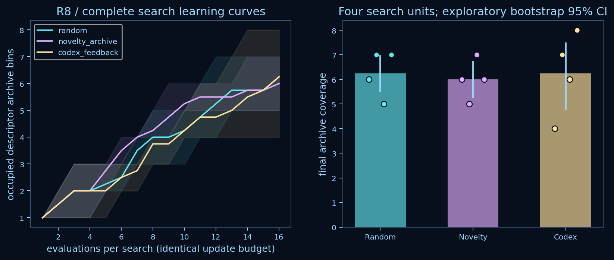

| Method | Coverage per search | Mean coverage; exploratory 95% interval | Mean nearest descriptor distance | Native engine / process seconds |
| --- | --- | --- | --- | --- |
| Random | 6, 7, 5, 7 | 6.25 [5.5, 7] | 0.1200 | 0.580 / 1.412 |
| Novelty | 6, 5, 7, 6 | 6 [5.25, 6.75] | 0.0739 | 0.566 / 0.878 |
| Codex | 4, 7, 6, 8 | 6.25 [4.75, 7.5] | 0.0721 | 0.566 / 0.883 |

Codex’s paired coverage difference from random is 0.0 bins (exploratory 95% interval −1.25 to 1.0); novelty is −0.25 (−1.5 to1.25). **This round establishes no Codex advantage.** Random also has higher descriptor diversity. These four search units estimate only this finite space and policy budget; they do not rank model intelligence or artistic quality. The broader space, horizon and budget differ from the original comparison, so their means are not a controlled before/after effect. [Complete results](results/discovery_art/summary.json).

The five serial discovery invocations measured 141.39 s in total, with peak orchestration RSS below 82 MiB; native engine time sums to 1.712 s and native process time to 3.173 s. Descriptor and file work dominate. Two feedback-to-submission wall intervals, 79.67 s and 96.35 s, include repository/tool work and are not isolated model latency. There were 48 conversational proposals and zero external or paid API calls; exact serving model, tokens and cost were not separately exposed. This is executed conversational assistance, with no automated model integration.

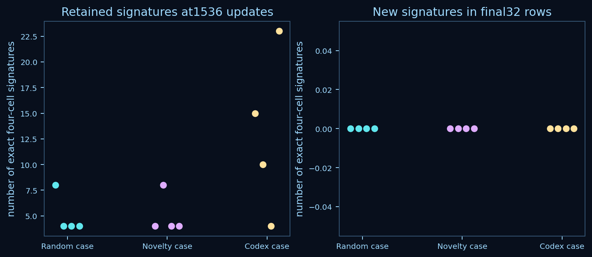

One occupied case per method was selected by retained signatures, then late novelty and descriptor novelty. Cases use spatial A:B halves, erasure with three initial types, and erasure with seven initial types. Four unseen seeds each run 1,536 updates. **All 12 recur and have zero unseen signatures in their final 32 rows.** Mean retained-signature counts are 5, 5 and 13, respectively. Repeated structure therefore survives without sustained signature innovation. These selected configurations are targeted cases, not representative samples. [Frozen follow-up](results/discovery_art/investigation/design.json), [complete outcomes](results/discovery_art/investigation/summary.json).

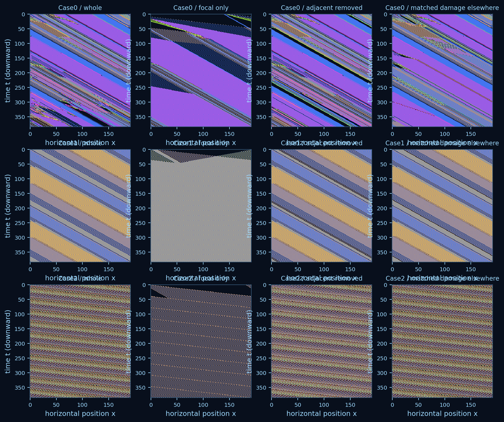

At saved t192, each case supplies its richest valid eight-cell focal window. Thirteen same-start assays include isolated halves, adjacent deletion, exactly matched count/value damage elsewhere, occupied-site/composition shuffles, whole-row shuffling, exact restoration and three constituent-rule controls. Extraction and edits are externally imposed. All three restorations and unedited continuations agree exactly with the corresponding source histories. Removing adjacent cells changes motif recovery differently from matched distant damage in two cases; that sensitivity alone does not establish symbiosis. The mixed case retains 19 new signatures in the assay’s final window versus zero in same-start A and B controls, a finite transient observation.

The novelty-selected erasure motif `[1,5,1,-3,1,5,1,-3]` remains present in all 385 isolated saved rows. Either four-cell half also restores the full template later and fills the ring, so appearance does not require copying every eight-cell founding component. Its maximum detached-template count remains one: this is persistent tiled spread. The other two isolated focal templates disappear after t0. Six complete two-update write audits agree with the numerical rows; none finds a certified internally supported full-founder pair. No child recovery probe is eligible. Certified ancestry covers only those two updates; changed, distributed or later descendants are outside that result. All 384-update numeric assays, failed hypotheses and lineage ambiguities remain retained.

| Interfaces work | High-resolution 4544 × 8830 print | Progressive reveal | Source recipe |
| --- | --- | --- | --- |
| Intervals | [PNG](results/art/r8-intervals.png) | [GIF](results/art/r8-intervals.gif) | [Recipe](results/art/r8-intervals.recipe.json) |
| Shear | [PNG](results/art/r8-shear.png) | [GIF](results/art/r8-shear.gif) | [Recipe](results/art/r8-shear.recipe.json) |
| Residue | [PNG](results/art/r8-residue.png) | [GIF](results/art/r8-residue.gif) | [Recipe](results/art/r8-residue.recipe.json) |

The new series is curated from actual viewed discovery histories, including random and conversationally proposed worlds. **Selection for beauty is independent of the method comparison.** Each work has four saved neighbors: changed seed, density, layout and rule; rule neighbors share the exact starting row. The atlas links source measurements, integer tables and coordinate-labelled enlarged pixel neighborhoods. Print rendering measured at most 351.80 MiB, separately from the search budget; 40-frame reveals stream one frame at a time. [Curation](results/discovery_art/curation.json), [all nearby results](results/discovery_art/nearby/manifest.json).

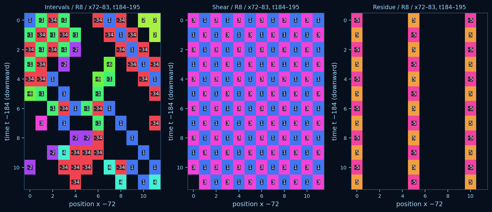

R8 closes with 261 new native worlds and 21,457,152 updates, exactly the declared 192 search plus 69 follow-up/neighborhood runs; no positive biological result was required. The next proposed question extends the actual exceptional mixed-rule source to 6,144 updates against matched A/B constituents, to separate its observed transient from sustained organization. [Round completion](results/discovery_art/completion.json), [proposed next experiment](results/discovery_art/next_experiment.json). Further calibration is not a prerequisite.

### Validated reconstruction

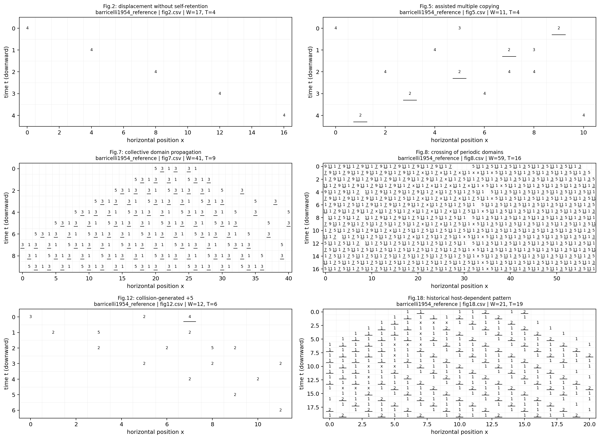

Figures 2, 5, 7, 8, 12 and 18 illustrate displacement, assisted copying, collective propagation, crossing, collision mutation and host-dependent patterns. All 22 examples agree exactly with the upstream executable and numerical fixtures. Each panel identifies its fixed initial-state reference, width and horizon. [Full agreement table](results/reconstruction/agreement.json).

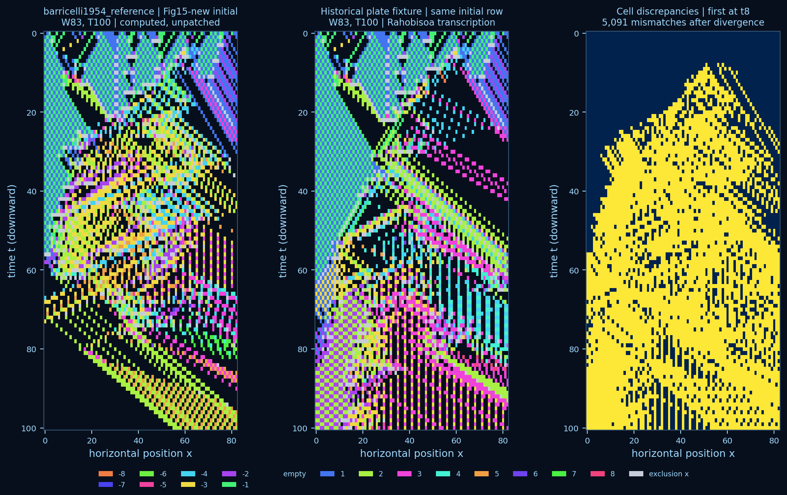

Figure 15 agrees with the corrected fixture. The historical-plate transcription first differs at time 8, positions 51, 56 and 58. Its 5,091 later unequal cells reflect propagated differences, rather than 5,091 independent historical errors. No cells were patched for visual agreement.

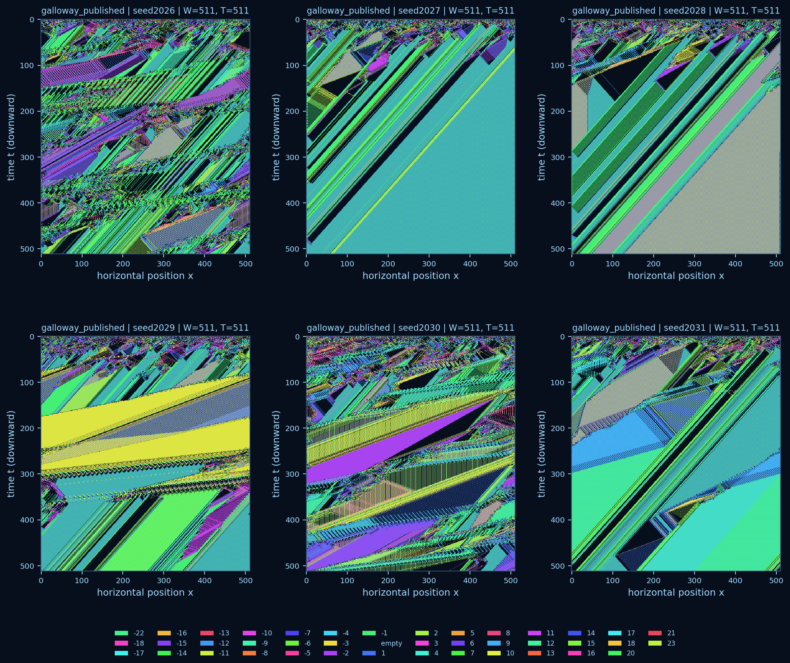

All six unselected display-scale initial rows (seeds 2026–2031) were run and checked against unchanged numerical method bodies compiled with Java. Six adversarial rows cover wrapping, equal helpers, mutation, occupied-target erasure and later reuse. There are zero numerical mismatches across 1,597,386 cells. This validates source-level arithmetic and update behavior, rather than the Processing UI, random stream or pixel identity of the original artwork. Final occupancies range from 236 to 510 of 511 cells. No whole-row recurrence is observed within this display horizon; it remains a finite observation.

### Discovery comparison and confirmation

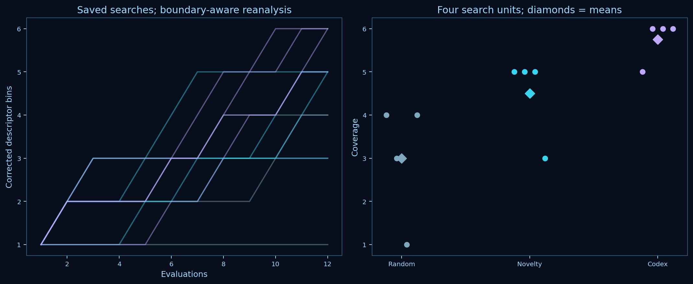

| Method | Coverage in four searches | Mean coverage; exploratory 95% interval | Mean nearest descriptor distance | Discovery native process time / descriptor time |
|---|---|---|---|---|
| Random | 4, 3, 1, 4 | 3.0 [1.75, 4.00] | 0.0571 | 1.07 s / 46.24 s |
| Novelty archive | 5, 5, 5, 3 | 4.5 [3.50, 5.00] | 0.0862 | 0.96 s / 47.65 s |
| Codex feedback | 5, 6, 6, 6 | 5.75 [5.25, 6.00] | 0.0994 | 1.11 s / 54.03 s |

All 144 evaluations are included. The corrected paired coverage differences from random are +1.5 bins for novelty and +2.75 for Codex; intervals and all units are in the correction report. Intervals bootstrap **search units**, not time points. Four units and a shared conversational context make these descriptive exploratory estimates. Descriptor evaluation dominates native simulation time. Two feedback-to-proposal wall intervals were 106.7 and 109.9 seconds, including other work; isolated model time, tokens and cost were not separately measurable. There were no external model API calls or paid calls. [The model-use record](results/model_use.json) separates proposal activity from an aggregate whole-goal usage meter. This is executed conversational Codex-assisted exploration, with no automated model integration.

All 12 fresh-state, longer-horizon checks recur by 1,024 updates and produce no unseen four-cell signatures in the final window. The selected Codex configuration yields one sparse moving recurrent pattern and three dense recurrent outcomes. The short-horizon archive gain therefore does not imply sustained innovation. [Corrected comparison](results/corrections/descriptor_v2/search_summary.json), [original comparison](results/search/summary.json), [feedback and proposal logs](results/search/), [confirmation outcomes](results/search_confirmation/summary.json).

### Heterogeneity: delayed recurrence, limited novelty

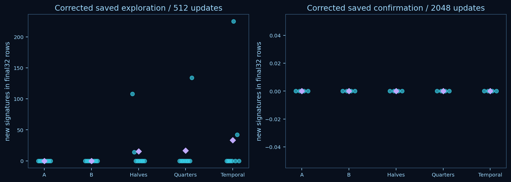

| Environment | Recurrence by 512, of 8 | Mean final-window new signatures at 512 | Recurrence by 2,048, of 4 | Mean new signatures at 2,048 |
|---|---:|---:|---:|---:|
| Homogeneous A | 7 | 0 | 4 | 0 |
| Homogeneous B | 7 | 0 | 4 | 0 |
| Spatial halves | 5 | 15.25 | 3 | 0 |
| Spatial quarters | 6 | 16.75 | 3 | 0 |
| Temporal A/B | 3 | 33.375 | 4 | 0 |

At 512 updates some mixtures retain local novelty while both homogeneous controls have none in their final windows. At 2,048 updates all confirmation worlds have zero late unseen signatures, including two spatial worlds without observed whole-world recurrence. Recurrence absence can therefore coexist with no measured new local structure.

Confirmation differences in retained signatures from the paired constituent mean are −1.25 for halves (interval −9.125 to 5.625) and −0.75 for quarters (−9.875 to 6.875). This small experiment gives no clear evidence that spatial heterogeneity sustains inherited organization. These signatures are not recoverable collective diversity or inherited variants. The 40 damage replays have mixed effects; mean repeated-window change ranges from −0.0904 in quarters to +0.0737 under temporal alternation, without an established collective recovery interpretation. [Corrected baselines, contrasts and damage outcomes](results/corrections/descriptor_v2/heterogeneity_summary.json), [original analyses](results/heterogeneity/summary.json).

### Partner specificity and the reproduction boundary

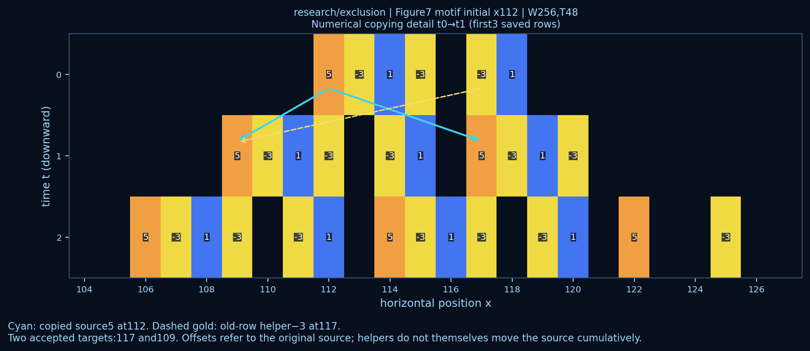

For the historical candidate at placement 112, the value 5 copies to 117, then the old-row helper −3 at 117 enables its copy to 109. Events record both source and partner. The original assay's deletion at motif offset 1 recovers after two updates in empty backgrounds. This unsuccessful partner-removal hypothesis remains in the results.

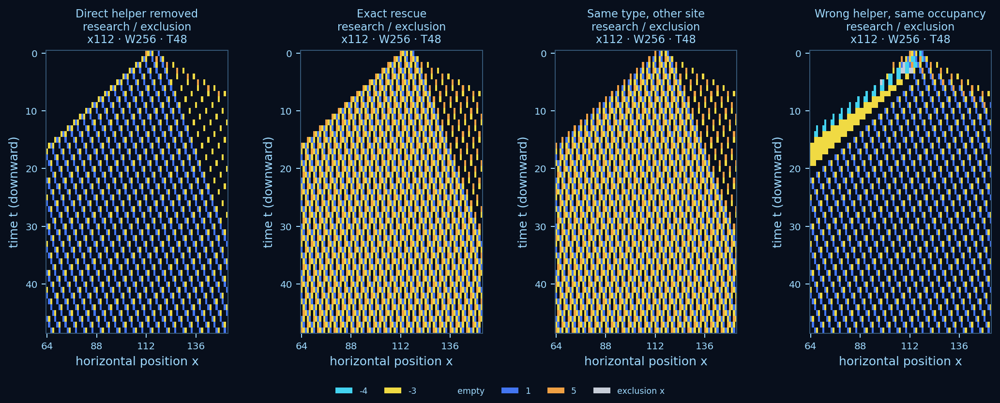

A separately declared, exploratory 24-run follow-up targets the direct helper at offset 5. Across all three empty-background placements, removing that helper or replacing −3 with −4 prevents recovery of the exact motif. Deleting the same numerical type at offset 1 allows recovery; restoring the direct helper reproduces the intact trajectory exactly. Resident backgrounds usually disrupt the motif. This supports arrangement-specific propagation, with gap-control imperfections still present.

The historical intact candidate reaches 21 disjoint matches in an occupied domain by time 48 at the central empty placement; the generated candidate reaches 25. **Neither produces additional detached recoverable copies under the assay criterion.** All 162 paired conditions, two viability probes and the follow-up are retained. The generated shuffle is effectively a phase shift, and its original ecology contains other matching templates, so template equality cannot resolve ancestry. No nonzero integer is a neutral filler. Removal changes occupancy and gap geometry; wrong-value replacement preserves those features but changes displacement. [Complete assay](results/assay/summary.json), [follow-up](results/partner_followup/summary.json), [all settings figure](results/figures/assay_all_settings.png).

### Detached-descendant detector: executed next experiment

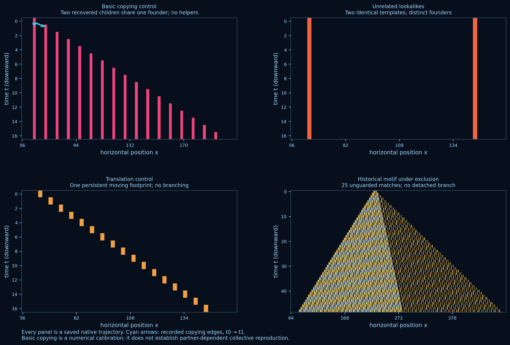

The predeclared detector follows every ordered numerical write, distinguishing copying parents from old-row helpers. Erasure clears copying support, replacement resets it, and mutations retain unknown origins. Equal-valued arrivals add ancestry alternatives. Each accepted child must contain a complete exact motif with two empty exterior cells on either side, exclusively trace to the declared founder, and have unambiguous copying support for every nonzero founding component. Two children must coexist, and both must retain the exact template through eight updates after separate isolation. These are operational numerical criteria, not biological ancestry labels.

Four native controls pass the declared checks. The basic-rule `[8,8]` founder produces detached copies and both selected children recover; it has no helper assistance and is reported as calibration. Two stationary `[1000,1000]` lookalikes remain unrelated, `[5,5]` translates as one footprint, and the historical motif creates 25 unguarded matches without a detached branch. All 21 fidelity and ancestry tests pass. Before opening confirmation, a logged code correction distinguished possible coverage from guaranteed representation of founding components; reanalysis changed no scientific outcome.

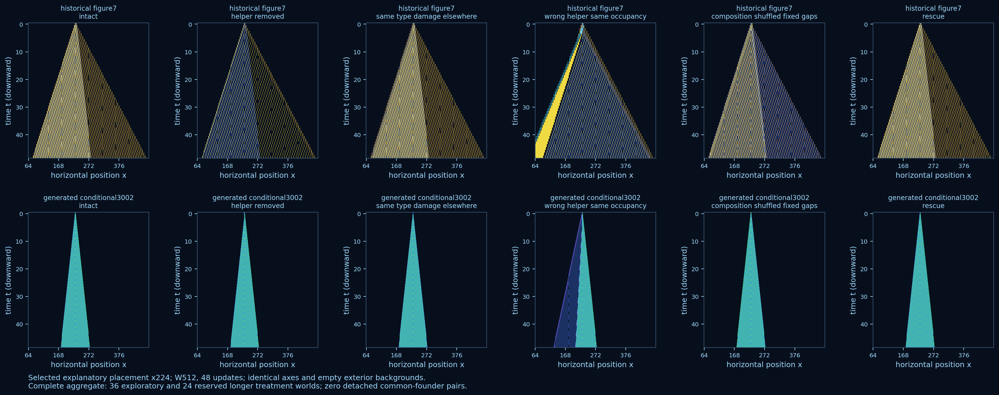

| Candidate | Exploration: 48 updates | Reserved check: 96 updates | Maximum unguarded matches, short / long | Maximum detached matches |
|---|---:|---:|---:|---:|
| Historical Figure 7 | 0 pairs / 18 worlds | 0 pairs / 12 worlds | 25 / 49 | 1 |
| Generated alternating motif | 0 pairs / 18 worlds | 0 pairs / 12 worlds | 25 / 49 | 1 |

Both cohorts use intact, helper removal, same-type damage, wrong-helper replacement, occupancy-preserving shuffle and exact rescue. All ten matched rescue settings reproduce their intact initial rows, trajectories and ordered events exactly. The historical helper removal and wrong-helper treatment never recover the exact template; same-type damage elsewhere recovers at time 2. The generated motif recovers after its declared perturbations at time 1, consistent with the earlier phase-shift and domain-growth caveats. Placements are deterministic robustness settings, not independent random biological replicates. R6 retains 64 baseline worlds and two recovery probes, consuming 3,284,992 cell updates. [Predeclared design](results/descendant_detector/design.json), [calibration](results/descendant_detector/calibration.json), [complete outcomes and paired effects](results/descendant_detector/summary.json), [analysis correction](results/descendant_detector/analysis-correction.json), [model-use scope](results/descendant_detector/model_use.json).

### Partner-assisted dyad: independently checked constructed positive

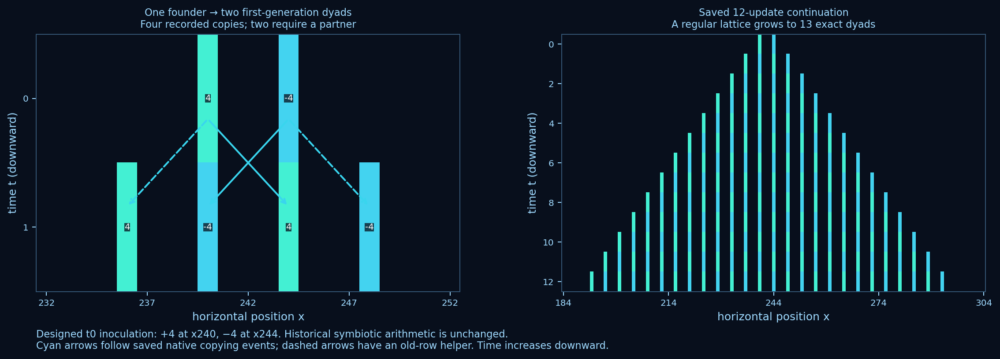

R7 freezes an analytical construction before execution: place `+d` at x and `−d` at x+d, with d≥3 and empty exterior. Taylor's unchanged historical symbiotic rule first copies each source onto its partner's old position, then uses that partner's displacement for a second copy. The four writes produce two exact dyads beginning at x−d and x+d. With d4, the founder at 240/244 produces children at 236/240 and 244/248. Each child contains both distinct original copying roots, meets the unchanged two-cell guard criterion and has an internal helper-enabled path. The original numerical engine and R6 detector were not changed.

Two additional verification paths agree. An [uninstrumented C++ harness](engine/symbiotic_oracle.cpp) includes Taylor's unchanged retained source and calls its original update functions, without linking the adapter or observational hooks. It matches every cell of all 78 R7 native histories. A [separate formula audit](barricelli/dyad.py), without the R6 lineage propagator, checks four source-specific edges and exactly two partner-enabled writes at the first update. Six adversarial tests reject missing helpers, equal-valued external founders, reordered or missing edges and occupied guards. Independence here means separate execution/audit paths in this session, not independent investigator replication.

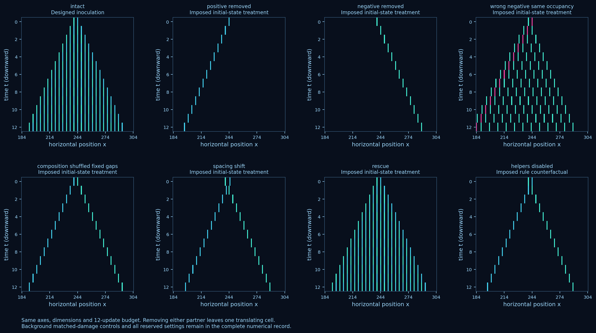

| Declared causal condition | First-step pair copying | Later exact dyads |
|---|---|---|
| Intact / exact rescue, four settings each | Pass in all four | 13 at t12; 97 at t96 |
| Either partner removed, four settings each | Fail in all four | Zero after t0 |
| Wrong negative value / fixed-site shuffle / spacing shift, four settings each | Fail in all four | Zero after t0 |
| Unrelated same-value background cell removed, construction setting | Pass | 13 at t12 |
| Focal partner removed from the matched background | Fail | Zero |
| Helper recursion suppressed, four oracle counterfactuals | Fail | Two translating cells; zero exact dyads after t0 |

The background control matches the number and value of removed cells outside the dyad's interaction cone. The two-cell founder has no dispensable internal component, so this is not an internal neutral-damage control. All four rescues restore saved numbers and ordered events exactly. Both components alone persist and translate; their interaction enables additional component copies rather than individual survival.

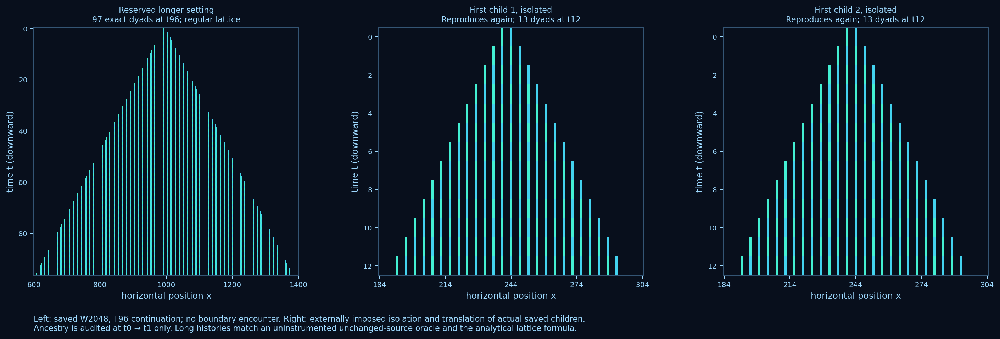

Both actual first children from each intact setting are extracted, translated to 240 in empty W512 worlds and tested separately. All eight reproduce at their first update after isolation and retain exact dyads through 12 updates. Isolation is an externally imposed assay. Three reserved checks—d3, d5 and a d4 W2048/T96 setting—pass all declared conditions. Intact histories match the boundary-free formula: at time t, dyads begin at x−dt+2dk for k=0…t, giving t+1 copies. Complete ancestry traces cover only t0→t1; longer histories are verified numerically, without a long-horizon lineage claim.

R7 retains62 baseline and 16 recovery native runs,1,603,584 cell updates and 1,665,024 oracle-matched saved cells. Four helper-disabled oracle trajectories are additional explicitly imposed rule controls, excluded from native experimental-unit counts. Native process time sums to 2.089 seconds; all oracle process time sums to 0.730 seconds. Confirmation orchestration measured7.46 seconds and 37.60 MiB peak RSS. One incomplete cache attempt was archived before correction. No new external model API calls were made. This targeted conversational construction is not another search-method comparison. [Frozen design](results/partner_dyad/design.json), [full results](results/partner_dyad/summary.json), [model-use record](results/partner_dyad/model_use.json), [preserved correction](results/partner_dyad/development/correction.json).

## Art, discussion and limitations

The local atlas exposes 72 saved worlds, including the detector controls, R7 copying and isolation assays, integer readouts, textual close-ups and progressive reveal. Four configuration neighbors and six dyad treatment neighbors can be compared directly. The original three selected artworks—*Confluence*, *Strata* and *Fault lines*—have 4919 × 4968 prints, streamed 40-frame GIFs and exact rendering recipes. Initial conditions, norm choices and curation are human/Codex design interventions; numerical structures arise through the simulator. A complete native-run register sits alongside the curated collection. The shared palette is expressive but does not distinguish every possible integer perceptually, so numerical views remain essential.

The reconstruction is the strongest result. The exploratory search gain is confined to a declared descriptor archive and a small budget; simpler periodic domains can score highly in activity, repetition and compression. [Saved diagnostic controls](results/figures/descriptor_controls.png) make this ambiguity visible: period-two motion has activity 1, while noise has high entropy without retained repeated structure. Neither implies life. Source-level fidelity also does not validate every historical verbal claim.

The recorded historical/generated motifs remain cases of domain propagation with partner-arrangement sensitivity. R7 adds a designed positive for partner-assisted numerical copying and isolated-child reproduction. It grows into a regular lattice whose inter-child gap equals its internal gap; spatial grouping is conventional and does not establish independently bounded organisms or evolved symbiosis. Exact templates may miss other distributed cooperation, phase cycles and changed descendants; requiring every founding component can also reject functional collectives whose redundant components turn over. Mutational dependency histories are incomplete and are conservatively excluded from certified paths. Motif extraction and the dependency-directed follow-up are exploratory, the resident background is a representative single realization, and longer confirmation cohorts are small. Long-horizon environment confirmation uses fresh states; exceptional exploratory histories were not individually extended beyond512 updates, so their longevity remains unresolved. The finite rule set and descriptor choices constrain discovery. No result here demonstrates open-ended evolution, intelligence or recursive self-improvement.

**Next scientific question:** does the actual exceptional R8 spatial mixture maintain late signature novelty through 6,144 updates against matched A/B controls, or does it coarsen into recurrence? The 12 fresh R8 long checks already recurred. Extend this specific original-state uncertainty with a bounded experiment and a numerical artwork; further calibration remains deferred.

## Checkpoint correction C1

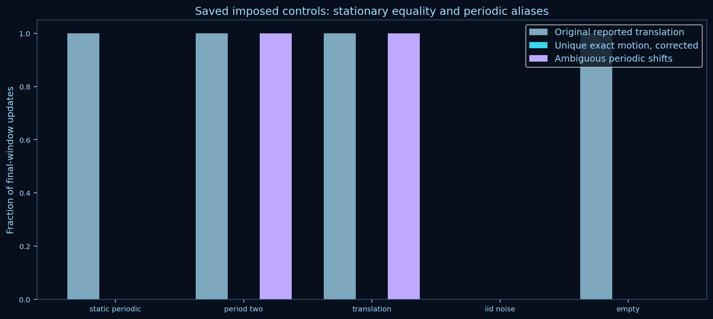

The build now probes usable native `std::format` without the compatibility include path; GCC11 here correctly selects the fallback. Stationary/empty equality takes precedence over periodic shift ties, aliased nonstationary shifts are reported separately, and open translations use zero exterior without accepting boundary loss. Four-cell windows and exact motif footprints respect open/ring boundaries. All 37 tests pass. Reanalysis changes 260 of 261 saved descriptor records, with no new scientific simulations or changed trajectories. Corrected historical coverage means are 3.0/4.5/5.75, versus original 3.0/4.5/5.5. These are corrected measurements of frozen original choices, not reruns of corrected adaptive policies. Longer environment novelty remains zero. [Preserved original analyses](results/corrections/descriptor_v2/original_analyses.tar.gz), [full correction and deltas](results/corrections/descriptor_v2/summary.json). R7’s three reserved settings and eight child assays were reverified from their completed, hash-checked native/oracle histories; no R7 run remains pending.

## Reproducibility

The saved laboratory contains **896 native runs and 45,257,353 cell updates**. Their complete current-engine replay checks 45,502,904 saved cells and all nine event counters. The maximum retained native footprint is3.75 MiB. The original491-run milestone regeneration completed in 53.29 s with a measured peak of 255.16 MiB; the 557-run R6 regeneration completed in 110.60 s at 255.04 MiB. These timings precede R7 and do not describe the expanded pipeline. R7 construction and confirmation resource records are separate. Timing is machine-dependent; native process time and engine time include CSV output, while descriptor, ancestry analysis, rendering, compilation, oracle and verification work have separate costs. [Current resource summary](results/resource_summary.json), [original regeneration](results/milestone-resource.txt), [R6 regeneration](results/milestone-r6-resource.txt), [R7 construction](results/partner_dyad/construction-fixed-resource.txt), [R7 confirmation](results/partner_dyad/confirmation-resource.txt), [preserved earlier metadata](results/regeneration_history/manifest.json), [machine record](results/machine.json), [replay report](results/replay_verification.json) and [test output](results/test-results.txt) provide measured scope. The development machine is an8-logical-CPU i5-1035G1 WSL2 instance with approximately3.7 GiB RAM and substantial existing swap use. Batches execute serially, native trajectories and ancestry evidence stream to disk, and GIF frames are streamed.

The complete cached pipeline was executed in 49.44 s at 275 MiB peak RSS, with 37 passing tests and no new scientific simulation/model call. All 5,319 tracked native artifacts retain their hashes; all 896 trajectories and nine event counters replay exactly. Six artwork final GIF crops, 26 figure-source hashes, local links and 13 browser assertions pass. [Current regeneration](results/reproduce-latest-resource.txt), [preservation audit](results/discovery_art/resume_verification.json), [browser checks](results/atlas_qa.json).

From the repository root:

```bash
python3 -m venv .venv
.venv/bin/pip install -r requirements.txt
make test
make reproduce                 # preserves originals, resumes recorded R8, verifies all; no model calls
make descendants               # resume/reanalyze only the predeclared R6 experiment
make partner-dyad              # resume R7, run independent checks, render its saved results
make corrections               # saved-history C1 reanalysis, originals retained
make discovery-art             # replay recorded R8 choices, assays and art; no model calls
.venv/bin/python scripts/replay_verify.py  # exact native replay, any compatible build
```

Replay and inspect the atlas by opening `atlas/index.html` in a browser, or serving the repository locally:

```bash
python3 -m http.server 8000 --bind 127.0.0.1
# Browse http://127.0.0.1:8000/atlas/
```

Run a named profile, render it separately, or explore a recorded neighborhood:

```bash
.venv/bin/python -m barricelli --config configs/galloway_published.json \
  --seed 2026 --steps 511 --output results/my_world
.venv/bin/python -m barricelli.plot results/my_world \
  --mode research --output results/my_world/view.png
.venv/bin/python scripts/nearby.py \
  --run results/search/codex_feedback/repeat3/trial07 \
  --output results/my_neighbors --seed 9300 --steps 1024
```

Routine `make reproduce` preserves original analyses and timings; `--regenerate-originals` on the milestone script explicitly archives metadata before rerunning them. R8 resumes require its recorded engine binary hash; `scripts/replay_verify.py` checks numerical compatibility across rebuilt binaries without altering saved runs.

`--initial-state path/to/initial.csv` supplies an exact integer row. Historical reference configurations reject altered figure horizons, rows or dimensions; deliberate changes require the research profile and declared modifications. The pinned environment needs Python 3.10+, g++, GNU time and system DejaVu fonts for prints. Java is needed only to regenerate the optional source-level oracle; frozen outputs support offline checks. Source retrieval scripts require network access, but simulation, plots, recorded search replay and the atlas require no model or hosted service. Optional browser QA uses a separately installed Playwright/Chromium development dependency.

The project remains compact: `engine/`, `barricelli/`, named `configs/`, numerical `fixtures/`, experiment/rendering `scripts/`, `results/`, the local `atlas/` and `references/`. [AGENTS.md](AGENTS.md) carries the mission, [RESEARCH_RECORD.md](RESEARCH_RECORD.md) records decisions and findings, and [DEVELOPMENT_LOG.md](DEVELOPMENT_LOG.md) records implementation history. [License and attribution](NOTICES.md) retain Taylor's GPL notices and acknowledge Galloway without redistributing his unlicensed sketch. GitHub commits checkpoint each completed design, implementation and experiment stage. The buildable [source snapshot](results/source_snapshot.tar.gz) and [manifest](references/source_manifest.json) provide additional content-based version identity; original run hashes remain recorded.
